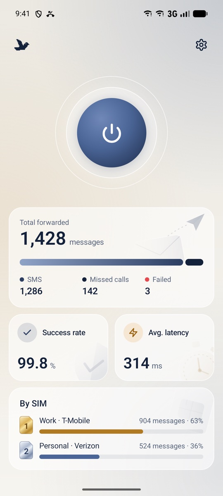
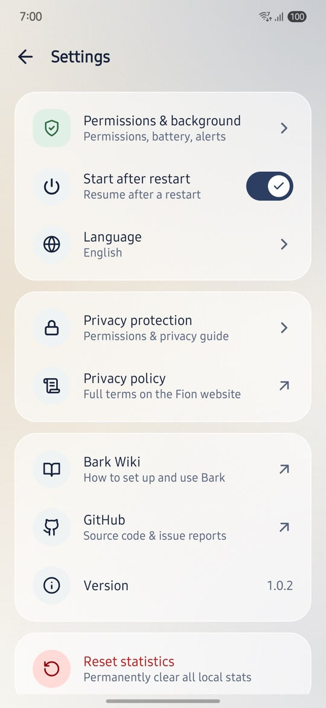
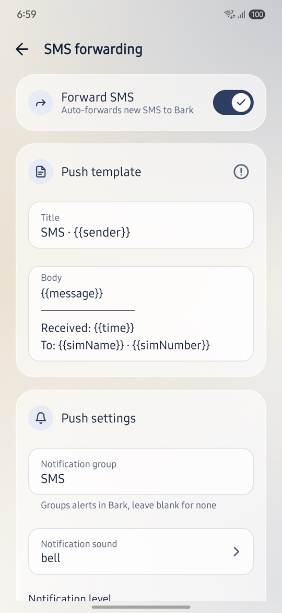
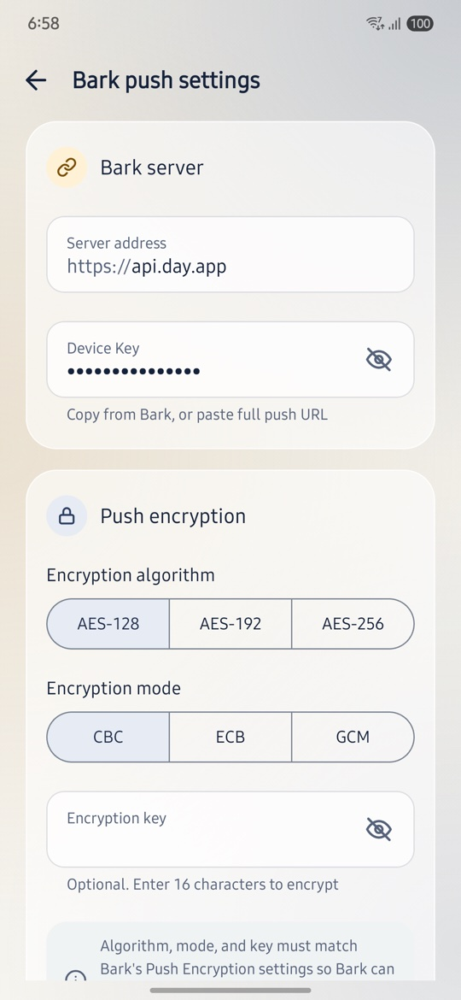
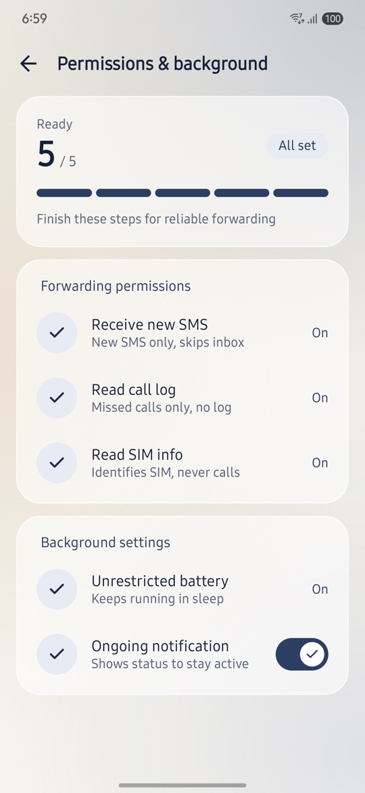
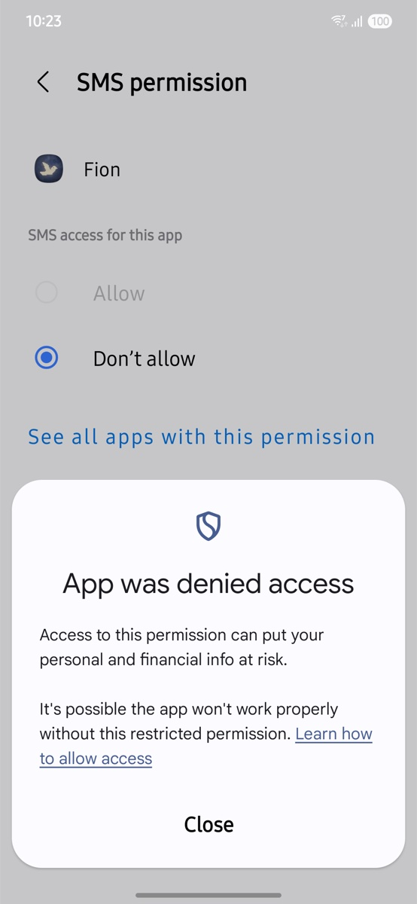
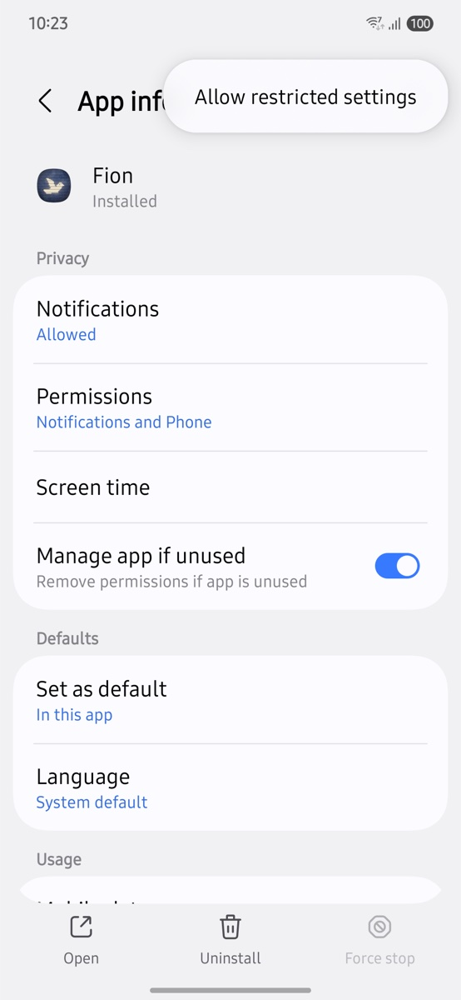

# Fion

Forward SMS and missed calls from your Android phone to [Bark](https://github.com/Finb/Bark).

English | [简体中文](README.zh-CN.md)

  
  
  
  
  

## Features

- Forward SMS and missed calls separately, each with its own template, group, sound, interruption level and history setting.
- Encrypt pushes with AES-128, AES-192 or AES-256 in CBC, ECB or GCM mode.
- Tell dual SIMs apart. Each push names the receiving SIM and its number.
- Queue messages while offline and resend them once the network is back.
- Track total forwarded, success rate, average latency and share per SIM.

## Privacy

- Fion sends no network requests other than pushes to the Bark server you configure.
- No analytics, no crash reporting, no update checks. Dependencies are AndroidX and kotlinx only.
- SMS and calls are parsed on the device. Message text and call details are never stored.

## Requirements

- Android 15 (API 35) or later.

## Install

1. Download `Fion-x.y.z.apk` from [Releases](../../releases) and install it.
2. Open the app and grant SMS, call log, phone number, notification and background permissions as guided.
3. Go to Settings → Bark channel and enter your server and Device Key.

### If SMS access is denied

Android blocks SMS and call log access for apps installed from an APK file and shows "App was denied access".

1. Open system Settings → Apps → Fion.
2. Tap ⋮ in the top right and choose "Allow restricted settings", then verify your identity. The ⋮ menu appears only after Android has denied the permission once.
3. Return to Fion and grant SMS and call log access again.

  
  

