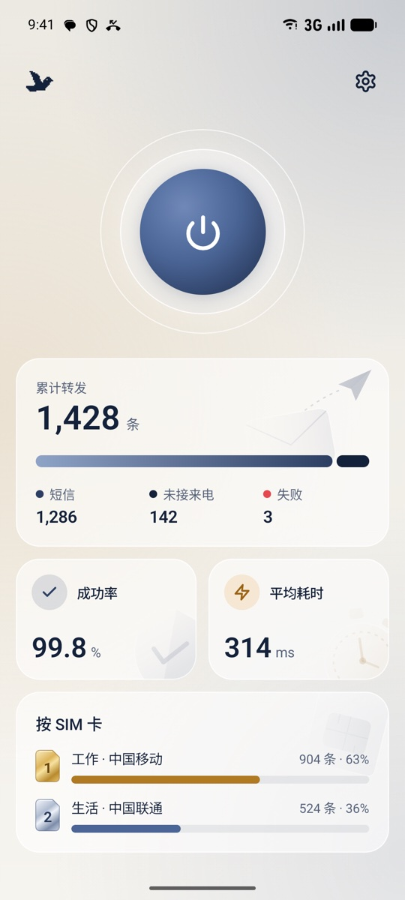
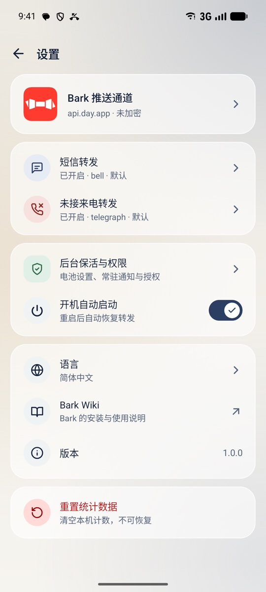
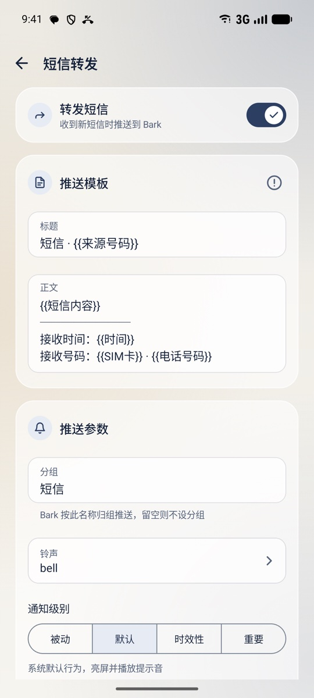
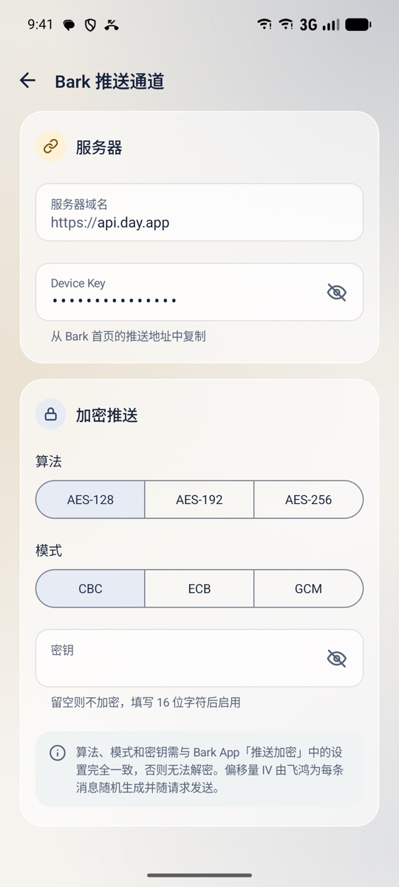
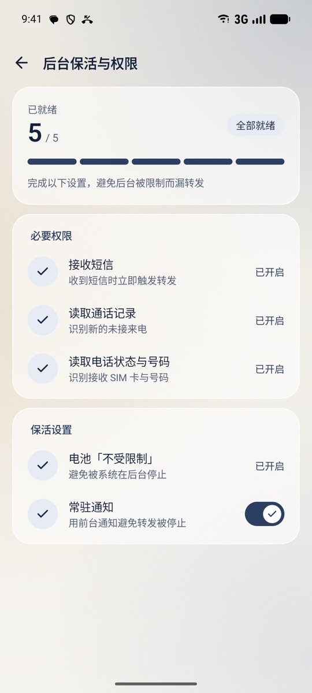
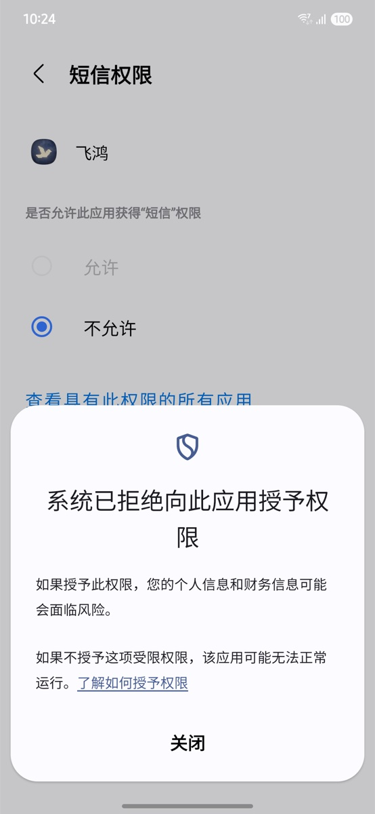
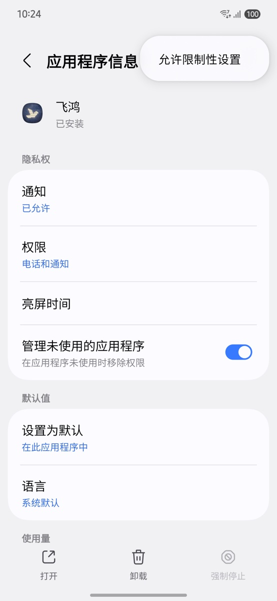

# Fion 飞鸿

把 Android 手机收到的短信与未接来电推送到 [Bark](https://github.com/Finb/Bark)。

[English](README.md) | 简体中文

  
  
  
  
  

## 功能

- 短信与未接来电分别转发，各自设置模板、分组、铃声、通知级别与是否保存历史。
- 支持 Bark 推送加密，AES-128、AES-192、AES-256 搭配 CBC、ECB、GCM。
- 区分双卡，推送内容标明接收的 SIM 卡与本机号码。
- 断网时消息进入待发队列，联网后自动补发。
- 首页统计累计转发、成功率、平均耗时与各 SIM 卡占比。

## 隐私

- 除推送到你配置的 Bark 服务器外，Fion 不发送任何网络请求。
- 不含统计分析、崩溃上报与版本检查，依赖仅有 AndroidX 与 kotlinx。
- 短信与来电只在本机解析，不保存短信原文与通话明细。

## 安装

1. 从 [Releases](../../releases) 下载 `Fion-x.y.z.apk` 并安装，系统需 Android 15 及以上。
2. 打开 App，按引导授予短信、通话记录、本机号码、通知与后台运行权限。
3. 进入「设置」→「Bark 推送通道」，填写服务器与 Device Key。

### 短信权限被拒绝时

Android 会拦截通过 APK 文件安装的应用读取短信与通话记录，并提示「系统已拒绝向此应用授予权限」。

1. 打开系统「设置」→「应用程序」→「飞鸿」。
2. 点右上角 ⋮，选择「允许限制性设置」并验证身份。系统拒绝过一次授权后，⋮ 菜单才会出现。
3. 回到飞鸿，重新授予短信与通话记录权限。

  
  

## 模板变量

标题与正文均为纯文本，`{{变量}}` 在推送时替换。

| 变量 | 含义 |
| :--- | :--- |
| `{{来源号码}}` | 对方号码 |
| `{{短信内容}}` | 短信全文 |
| `{{来电次数}}` | 该号码今日来电次数 |
| `{{时间}}` | 接收时间 |
| `{{运营商}}` | 接收 SIM 卡的运营商 |
| `{{SIM卡}}` | 接收 SIM 卡的名称 |
| `{{电话号码}}` | 接收 SIM 卡的本机号码 |

## 许可证

[GPL-3.0](LICENSE)
